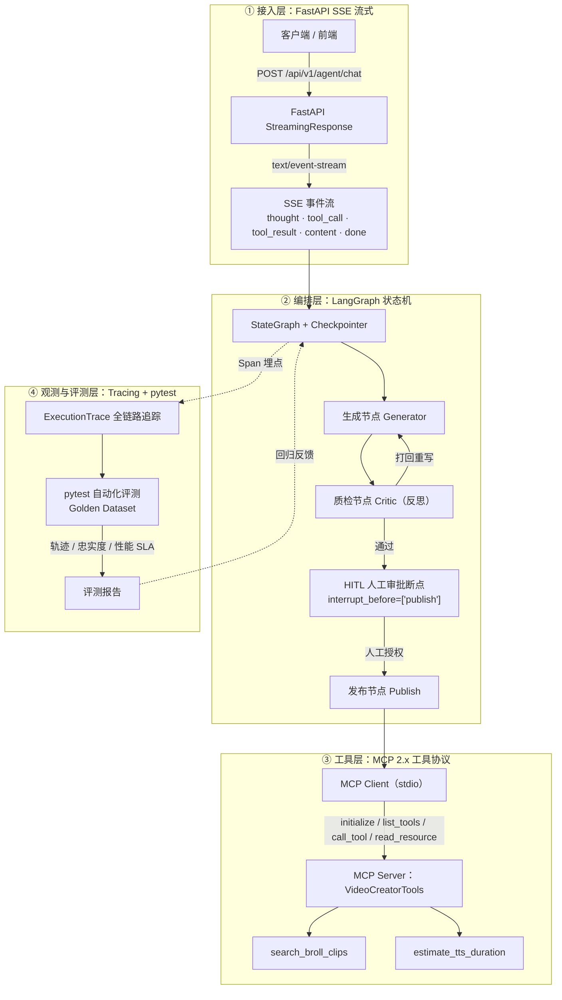

# Production-Agent-Architecture-Demo

面向生产环境的多智能体（Multi-Agent）工程架构演示项目。围绕 **FastAPI SSE 流式接入 → LangGraph 状态机与 HITL 人工审批断点 → MCP 2.x 标准化工具协议 → 全链路 Tracing 与 pytest 自动化评测** 的完整闭环，展示一个可落地、可观测、可评测的 LLM Agent 系统应当如何组织与实现。

> 设计目标：聚焦 LLM Agent 从「原型验证」走向「生产落地」的核心工程挑战，完整沉淀连接中断治理、有向循环图熔断、持久化状态断点恢复、MCP 标准化工具解耦及轨迹级自动化回归评测等工业级基础设施实践。

## 系统架构

### 架构总览



### 请求生命周期（端到端闭环）

1. 客户端通过 `POST /api/v1/agent/chat` 发起请求，FastAPI 以 `StreamingResponse` 返回 `text/event-stream` 流（`X-Accel-Buffering: no` 防止 Nginx 反向代理缓存）。
2. 编排层基于 LangGraph 构建状态图，经历「生成 → 反思质检」循环，达标后进入 HITL 断点挂起，等待人工审批。
3. 人工批准后调用 MCP 客户端，通过标准协议动态发现并调用工具（B-Roll 素材检索、TTS 时长估算等）。
4. 每一步都通过 ExecutionTrace 记录 Span 埋点，最终由 pytest 黄金数据集对工具轨迹、输出忠实度、性能 SLA 进行回归验证。

## 目录结构

```
Production-Agent-Architecture-Demo/
├── agent_server.py          # ① 接入层：FastAPI SSE 流式服务 + Pydantic 强类型契约
├── real_llm_agent.py        # 结构化输出：ChatOpenAI.with_structured_output + 字段级业务校验
├── hitl_graph.py            # ② HITL：LangGraph 断点挂起 + 人工审批 + 状态恢复
├── reflection_graph.py      # ② Reflection：生成-反思循环 + 条件路由 + 死循环熔断
├── video_mcp_server.py      # ③ MCP 2.x 工具服务器（Tool + Resource）
├── mcp_client_test.py       # ③ MCP 客户端：协议握手、工具发现、调用与资源读取
├── observable_agent.py      # ④ 全链路 Tracing：Span 埋点 + 轨迹记录
├── test_agent_eval.py       # ④ pytest 自动化评测：黄金数据集三维断言
├── requirements.txt         # 核心依赖清单
├── .env.example             # 环境变量示例（复制为 .env 使用）
├── .gitignore               # 敏感信息与虚拟环境隔离
└── README.md
```

## 核心技术亮点

### 1. FastAPI SSE 流式接入（`agent_server.py`）
- 严格遵循 SSE 协议格式（`data: <json>\n\n`），事件类型用 `Literal` 强约束。
- 捕获 `asyncio.CancelledError`，应对前端主动断开连接（用户点击「停止生成」）。
- 并行工具调用（`asyncio.gather` + `return_exceptions=True`），单工具异常不中断整体流程，并带降级兜底。
- 关键工程细节：`X-Accel-Buffering: no` 防止 Nginx 反向代理缓存 SSE 流。

### 2. LangGraph 状态机 + HITL 人工审批断点（`hitl_graph.py` / `reflection_graph.py`）
- `MemorySaver` Checkpointer 持久化会话状态（生产环境可无缝替换 PostgresSaver / RedisSaver）。
- `interrupt_before=["publish"]` 在对外发布等高风险节点前强制挂起。
- `graph.update_state()` 支持人工在断点处动态修改状态（润色 + 授权）。
- Reflection 反思模式：Critic 质检节点 + 条件路由打回重写，`MAX_REVISIONS` 熔断防止死循环烧 Token。

### 3. MCP 2.x 标准化工具协议（`video_mcp_server.py` / `mcp_client_test.py`）
- 服务端以声明式 `@mcp.tool()` / `@mcp.resource()` 暴露工具与资源，自动生成参数 Schema。
- 客户端走标准 `initialize → list_tools → call_tool → read_resource` 流程，工具动态发现而非硬编码。

### 4. Pydantic 强类型结构化输出（`real_llm_agent.py`）
- `with_structured_output` 绑定 Pydantic Schema，强制大模型输出可直接映射为强类型对象。
- `field_validator` 做业务级校验（拒绝「无 / 待定 / N/A」等无效占位参数）。
- 兼容任意 OpenAI 协议平台（DeepSeek / 火山方舟 / 通义千问），通过环境变量切换。

### 5. 全链路 Tracing + pytest 自动化评测（`observable_agent.py` / `test_agent_eval.py`）
- 轻量级 `Span` 埋点，记录每步的输入 / 输出 / 耗时 / 状态。
- 黄金数据集覆盖单工具意图、多工具协同、模糊输入兜底等边界 Case。
- 三维断言：工具调用轨迹准确率、输出忠实度、性能 SLA。

## 本地快速启动

### 环境准备

```bash
# 1. 创建并激活虚拟环境
python -m venv .venv

# Windows
.venv\Scripts\activate

# Linux / macOS
source .venv/bin/activate

# 2. 安装依赖
pip install -r requirements.txt

# 3. 配置环境变量（复制后填入真实密钥）
# Windows
copy .env.example .env
# Linux / macOS
cp .env.example .env
```

### 运行各模块

```bash
# ① 启动 FastAPI SSE 流式服务（http://127.0.0.1:8000）
python agent_server.py

# ② LangGraph 生成-反思循环演示
python reflection_graph.py

# ② HITL 人工审批断点演示（会提示输入 y/n 模拟人工审批）
python hitl_graph.py

# 结构化输出演示（未配置 Key 时自动进入本地校验演示模式）
python real_llm_agent.py

# ③ MCP 工具服务器
python video_mcp_server.py

# ③ MCP 客户端（自动拉起 video_mcp_server.py 并完成协议交互）
python mcp_client_test.py
```

### 运行自动化评测

```bash
pytest -v
```

预期输出：4 个用例全部通过（TC_001 单工具检索 / TC_002 单工具时长 / TC_003 多工具协同 / TC_004 模糊输入兜底）。

## 技术栈

| 组件 | 技术 | 职责 |
| --- | --- | --- |
| 接入层 | FastAPI + Uvicorn + SSE | 流式接入、强类型契约 |
| 编排层 | LangGraph | 状态机、HITL 断点、反思循环 |
| 工具层 | MCP 2.x | 标准化工具协议与动态发现 |
| 大模型 | LangChain-OpenAI | 兼容多平台的结构化输出 |
| 观测评测 | pytest + 自研 Tracing | 全链路追踪与自动化回归 |

## 安全说明

- 本项目**不包含任何真实密钥**，敏感信息通过 `.env`（已被 `.gitignore` 忽略）注入。
- 如使用真实模型，请通过 `.env.example` 模板复制 `.env` 并填入自己的 `OPENAI_API_KEY`，切勿硬编码或提交。
